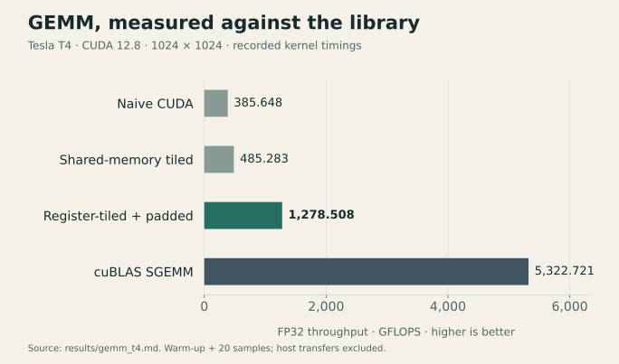

# CUDA Transformer Kernels

**Follow a performance decision from the kernel to the measurement.**

FP32 matrix multiplication and row-wise Softmax in C++/CUDA, with CPU references, cuBLAS comparisons and NVIDIA Nsight Compute analysis on a Tesla T4.

[Kernel source](src/) · [Full results](results/) · [Optimization notes](docs/optimization.md) · [Benchmark protocol](docs/benchmark-method.md) · [Validation](docs/validation.md)



The custom kernel reaches **1.28 TFLOPS**, about **3.32× the naive implementation** and **24.0% of cuBLAS** in this workload. The library baseline stays visible to put the improvement in context.

## Two decisions worth inspecting

**Reuse work before adding machinery.** GEMM progressed from global-memory loads to shared-memory tiling, then register tiling and padded shared-memory strides. Nsight guided the changes. The original profiling account reports fewer bank conflicts, but raw profiler exports were not retained: [experiment narrative and evidence limits](docs/optimization.md).

**Keep the measured winner.** At 1024 rows × 2048 columns, register-cached Softmax reached **27.003 billion elements/s**, versus **15.746** for the naive kernel and **24.291** for warp shuffles. Register caching is about **1.71×** the baseline here; it is not fastest at every row width. [All Softmax sizes](results/softmax_t4.md).

## Reproduce the checks

CMake and a C++17 compiler are enough for the CPU path:

```sh
cmake -S . -B build -DCMAKE_BUILD_TYPE=Release
cmake --build build --parallel
ctest --test-dir build --output-on-failure
```

On a Tesla T4 with the CUDA Toolkit and cuBLAS installed:

```sh
cmake -S . -B build-gpu -DCMAKE_BUILD_TYPE=Release \
  -DCMAKE_CUDA_ARCHITECTURES=75 -DBUILD_GPU_TESTS=ON
cmake --build build-gpu --parallel
ctest --test-dir build-gpu --output-on-failure
./build-gpu/benchmark_matmul_cuda
./build-gpu/benchmark_softmax_cuda
```

[Other build options and implementation map](docs/optimization.md#building) · [Supported inputs and test coverage](docs/validation.md)

## What the numbers establish

- **Historical T4 / CUDA 12.8 results.** Warm-up followed by 20 CUDA-event timings. The harness reports the upper central sample, not the mean of the two central samples.
- **Kernel time only.** Host allocation, transfers, networking and application work are excluded. CPU references ran on a different system and are not a hardware speedup baseline.
- **Current GPU verification is pending.** CPU regression checks exist; the latest GPU validation changes have not been compiled or rerun on GPU hardware. Cached Softmax variants support widths up to 2048.

These are kernel experiments, not a transformer library or a replacement for cuBLAS. Preserve dated measurements when rerunning; the [benchmark guide](docs/benchmark-method.md) lists the environment and raw evidence to retain.
